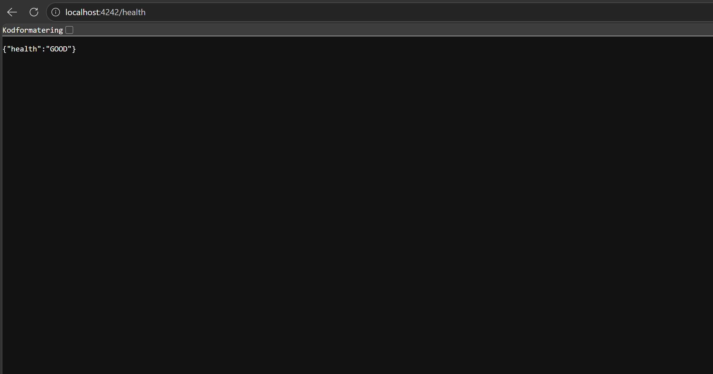

## Steg 4
- Bygger på unleashorg/unleash-server:7 (låst version)
- Kollade med whoami: körs som node, inte root. Satte USER node tydligt
- Hälsokoll mot /health med wget (kollade först att wget finns)
- Compose använder nu build: ./unleash istället för färdig image

## Steg 5: Flask kopplad till Unleash
- Flaggan show-task-priority styr om uppgifter får prioritet
- Problem: prioritet visades aldrig, appen syntes inte i Unleash, inga fel i loggarna
- Felsökning, ett steg i taget:
  - Slog på loggning i Flask (logging.basicConfig), biblioteket var tyst
  - Testade nätverket inifrån Flask: /health svarade GOOD
  - Testade nyckeln med ett anrop mot /api/client/features: fungerade
  - Testade biblioteket ensamt i containern: True
  - Slutsats: felet låg i appens kod
- Orsak: raden unleash.initialize_client() saknades, klienten startade aldrig
- Lösning: lade till raden, appen syns nu under Applications i Unleash
- Test: samma curl-anrop ger priority med flaggan på, ingen priority med flaggan av

## Steg 7: Budgetlarm
- Budget på hela prenumerationen, med larm vid 50 %
- Skapad manuellt i portalen, inte i Terraform, så att terraform destroy inte tar bort skyddsnätet

## Steg 8: Terraform bootstrap
- Delade Terraform i bootstrap/ (state-lagring, körs en gång) och infra/ (projektet)
- Skapade resursgruppen med kod i stället för i portalen som i projekt 1

- Storage Account för state: TLS 1.2, inga publika filer, versionering påslagen
- Container "tfstate" där infra sparar sin state
- Referenser (azurerm_resource_group.main.name) i stället för hårdkodade namn

- infra/provider.tf har backend "azurerm", state sparas som infra.tfstate i Azure
- Backend-blocket kan inte använda referenser, eftersom det läses före allt annat

## Steg 9: Nätverk
- VNet 10.0.0.0/16 med två subnät: snet-apps (Container Apps) och snet-db (PostgreSQL)
- Delegering reserverar varje subnät för en tjänst
- Referenser i stället för hårdkodade namn, så att Terraform skapar saker i rätt ordning

## Steg 10: Databas och Key Vault

### Vad jag byggde
- PostgreSQL Flexible Server (v16, B1ms) i det privata subnätet snet-db, ingen publik åtkomst
- Privat DNS-zon kopplad till VNet:et, så att apparna hittar databasen med namn i stället för IP
- Databaslösenordet genereras av Terraform (random_password), ingen människa skriver det
- Key Vault med RBAC (roller i stället för access policies). Lösenordet sparas som hemligheten db-password
- Mig själv som "Key Vault Secrets Officer", så att Terraform får skriva hemligheten

### Problem jag löste
1. **Varning: enable_rbac_authorization deprecated**
   - Upptäckte med `terraform validate` (VS Code visade bara rött)
   - Lösning: bytte till det nya namnet `rbac_authorization_enabled`
   - Lärdom: lita på `terraform validate`, inte på editorns färger

2. **RegionalAllocationFailed**
   - Azure hade slut på kapacitet för B1ms i Sweden Central
   - Lösning: bytte region till North Europe, en enda rad tack vare referenser

3. **Resursgruppen gick inte att radera ("still contains Resources")**
   - En DNS-zon låg kvar efter databasen som misslyckades
   - Lösning: `prevent_deletion_if_contains_resources = false` i infra/provider.tf
   - OK i dev (gruppen innehåller bara mina resurser), skulle behållas i produktion

4. **Resurser försvann direkt efter att de skapats ("Root object was present, but now absent")**
   - Orsak: Azure raderade fortfarande en resursgrupp med samma namn i bakgrunden
   - Följdfel: Azure och Terraform state blev osynkade ("already exists")
   - Felsökning: `az group show` och `az postgres flexible-server show` för att se verkligt läge
   - Lösning: nya namn (rg-unleash-app, psql-omer-unleash-ne, kv-omer-unleash-ne),
     tömde state med `terraform state rm` och byggde om. 12 resurser skapades
   - Lärdom: när Azure och state är osynkade är en ren omstart ofta snabbare än att lappa

### Kostnad
- Databasen kostar per timme. Vid kort paus: `az postgres flexible-server stop`
  (bara lagring kostar, startar automatiskt efter 7 dagar). Vid längre paus: `terraform destroy`