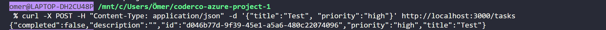

## Steg 4
- Bygger på unleashorg/unleash-server:7 (låst version)
- Kollade med whoami: körs som node, inte root. Satte USER node tydligt
- Hälsokoll mot /health med wget (kollade först att wget finns)
- Compose använder nu build: ./unleash istället för färdig image

## Steg 5: Flask kopplad till Unleash
- Flaggan show-task-priority styr om uppgifter får prioritet
- Problem: prioritet visades aldrig, appen syntes inte i Unleash, inga fel i loggarna
- Felsökning, ett steg i taget:
  - Slog på loggning i Flask (logging.basicConfig), biblioteket var tyst
  - Testade nätverket inifrån Flask: /health svarade GOOD
  - Testade nyckeln med ett anrop mot /api/client/features: fungerade
  - Testade biblioteket ensamt i containern: True
  - Slutsats: felet låg i appens kod
- Orsak: raden unleash.initialize_client() saknades, klienten startade aldrig
- Lösning: lade till raden, appen syns nu under Applications i Unleash
- Test: samma curl-anrop ger priority med flaggan på, ingen priority med flaggan av

