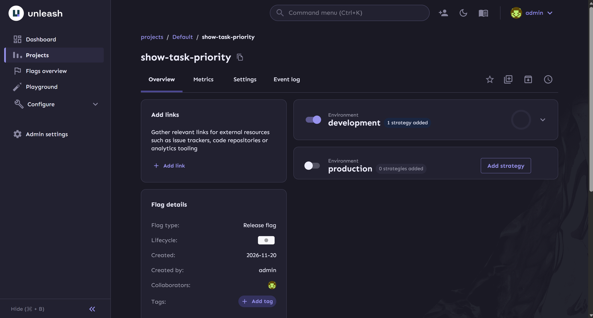
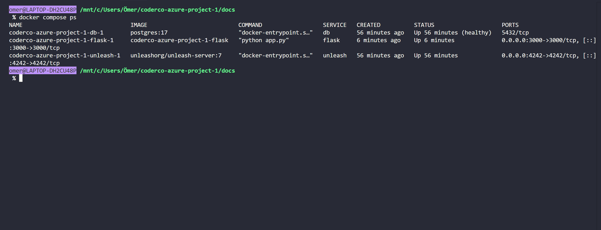
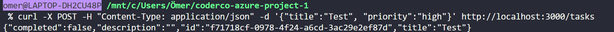

## Steg 4
- Bygger på unleashorg/unleash-server:7 (låst version)
- Kollade med whoami: körs som node, inte root. Satte USER node tydligt
- Hälsokoll mot /health med wget (kollade först att wget finns)
- Compose använder nu build: ./unleash istället för färdig image

## Steg 5: Flask kopplad till Unleash
- Flaggan show-task-priority styr om uppgifter får prioritet
- Problem: prioritet visades aldrig, appen syntes inte i Unleash, inga fel i loggarna
- Felsökning, ett steg i taget:
  - Slog på loggning i Flask (logging.basicConfig), biblioteket var tyst
  - Testade nätverket inifrån Flask: /health svarade GOOD
  - Testade nyckeln med ett anrop mot /api/client/features: fungerade
  - Testade biblioteket ensamt i containern: True
  - Slutsats: felet låg i appens kod
- Orsak: raden unleash.initialize_client() saknades, klienten startade aldrig
- Lösning: lade till raden, appen syns nu under Applications i Unleash
- Test: samma curl-anrop ger priority med flaggan på, ingen priority med flaggan av

## Steg 7: Budgetlarm
- Budget på hela prenumerationen, med larm vid 50 %
- Skapad manuellt i portalen, inte i Terraform, så att terraform destroy inte tar bort skyddsnätet

## Steg 8: Terraform bootstrap
- Delade Terraform i bootstrap/ (state-lagring, körs en gång) och infra/ (projektet)
- Skapade resursgruppen med kod i stället för i portalen som i projekt 1

- Storage Account för state: TLS 1.2, inga publika filer, versionering påslagen
- Container "tfstate" där infra sparar sin state
- Referenser (azurerm_resource_group.main.name) i stället för hårdkodade namn

- infra/provider.tf har backend "azurerm", state sparas som infra.tfstate i Azure
- Backend-blocket kan inte använda referenser, eftersom det läses före allt annat

## Steg 9: Nätverk
- VNet 10.0.0.0/16 med två subnät: snet-apps (Container Apps) och snet-db (PostgreSQL)
- Delegering reserverar varje subnät för en tjänst
- Referenser i stället för hårdkodade namn, så att Terraform skapar saker i rätt ordning

## Steg 10: Databas och Key Vault
- PostgreSQL i privat subnät, Key Vault med RBAC, lösenord från random_password
- Problem 1: RegionalAllocationFailed i Sweden Central (Azure hade slut på kapacitet)
  - Lösning: bytte region till North Europe
- Problem 2: resurser försvann direkt efter att de skapats ("Root object was present, but now absent")
  - Orsak: Azure raderade fortfarande en resursgrupp med samma namn i bakgrunden
  - Lösning: nytt namn på resursgruppen, tömde Terraform state och byggde om
- Lärdom: när Azure och state blir osynkade är en ren omstart ofta snabbare än att lappa